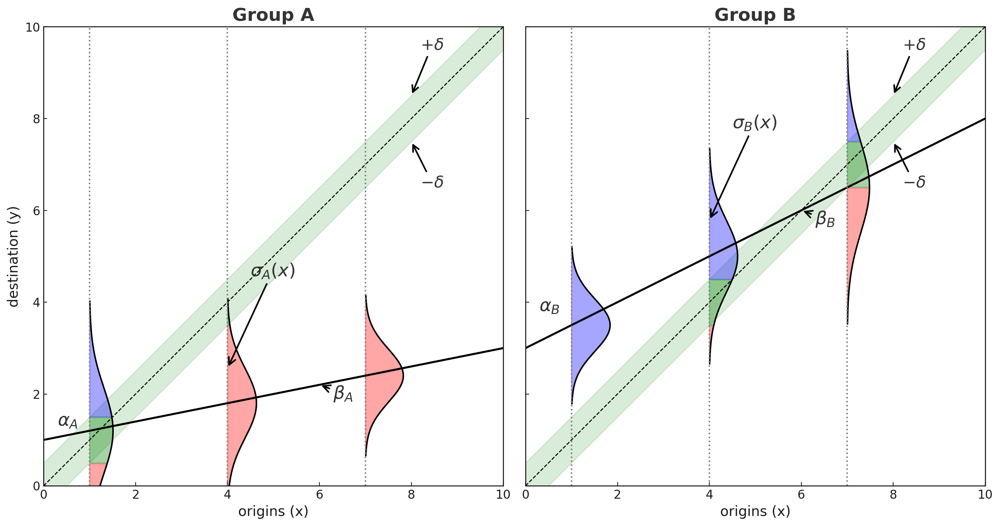
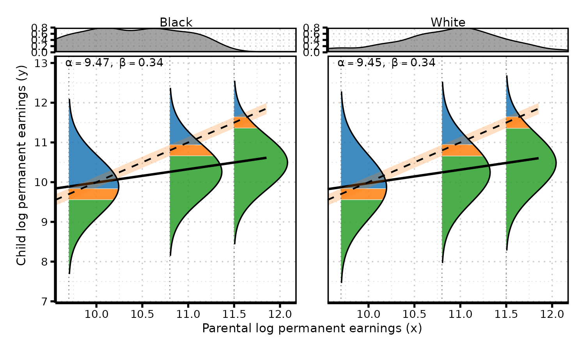
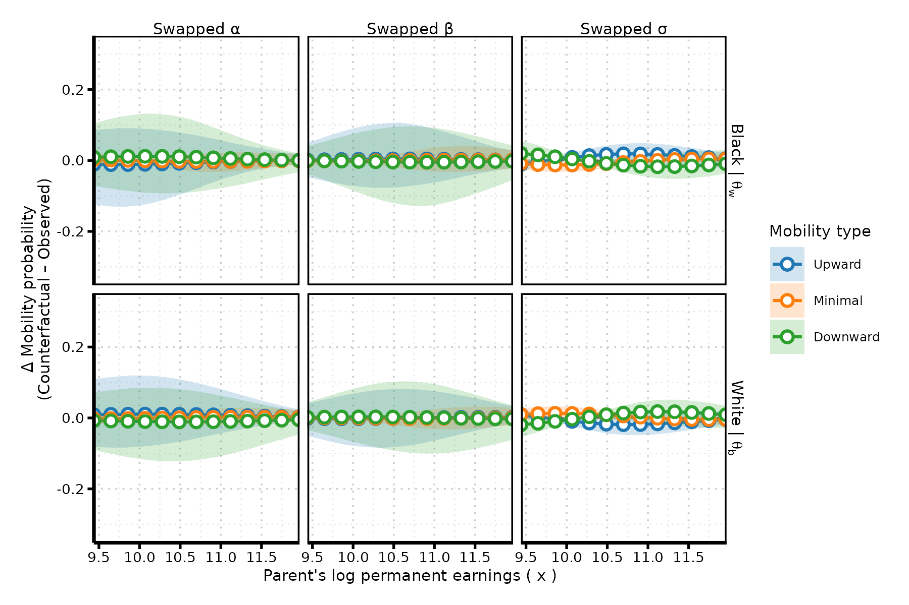
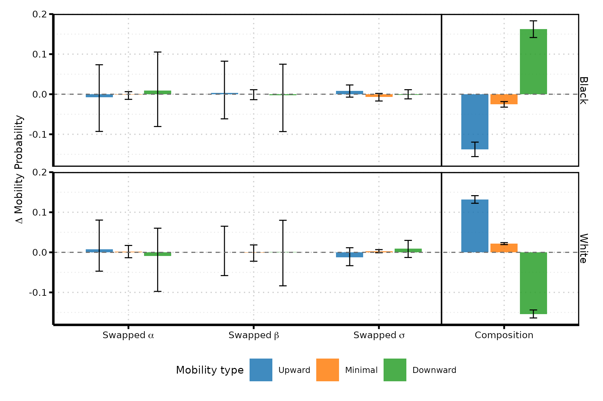
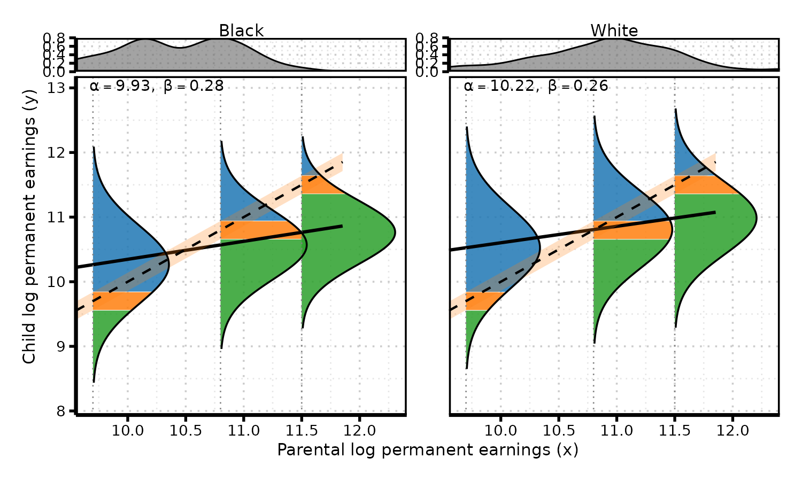
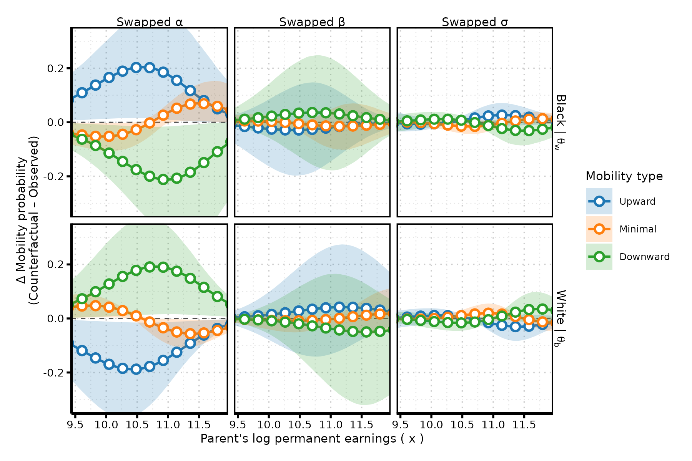
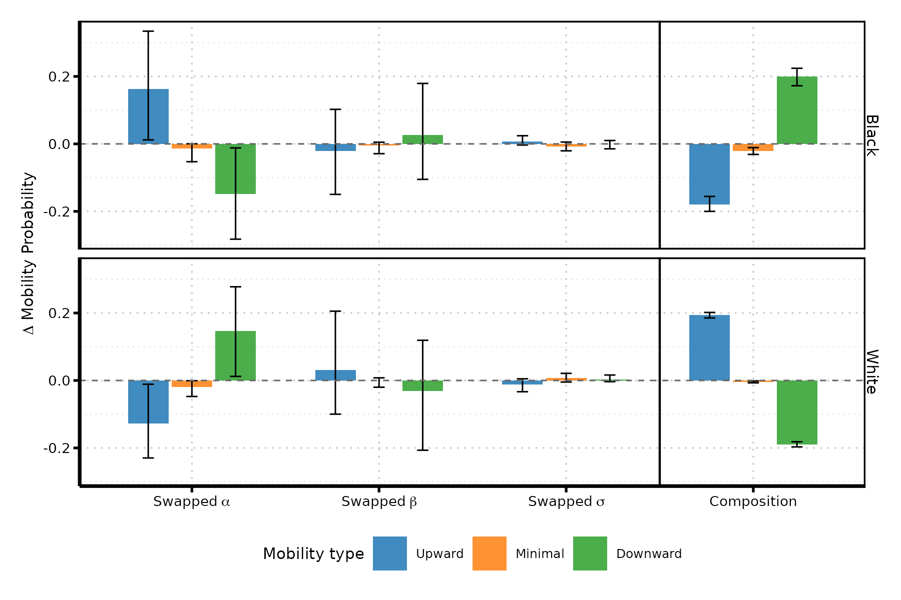

# the problem {.center-slide}

------------------------------------------------------------------------

## context

::: {.incremental}

- social mobility is a central theme in public discussions about fairnessa nd opportunity.
  
- commonly invoked as a public good: metaphors like “the social elevator” or a “level playing field” signal that rising should be attainable for all.
:::

------------------------------------------------------------------------

## the problem

::: {.incremental}
-   social mobility means different things in public debate and academic research

-   two core concepts are often conflated:
    -   **relative mobility:** how tightly children's positions track their parents'
    -   **absolute mobility:** where children end up compared with their parents (in levels)

 

-   so what counts as **"good" or "bad" mobility**? seems straightforward enough...
    -   weaker parent-child associations → more "equality of opportunity"
    -   more people surpassing their parents → more upward mobility

 

-   **but not so fast!**: these two mobility types can move in opposite directions and have different consequences for individuals within the same society.

:::

------------------------------------------------------------------------

::::: columns
::: {.column width="45%"}

:::

::: {.column width="55%" style="padding-left:45px;"}

:::
:::::

------------------------------------------------------------------------

::::: columns
::: {.column width="45%"}

:::

::: {.column width="55%" style="padding-left:45px;"}

::: {.incremental}
**two ways this story could be true:**

1.  the bus driver's son ends up owning the bus company, while the doctor's son winds up driving the bus *(rank reversal)*

2.  the bus driver's son owns the bus company, and the doctor's son owns the clinic *(upward mobility for both)*
:::

:::
:::::

------------------------------------------------------------------------

## this paper

 

**core claim:** properly understanding mobility requires examining both types simultaneously. this paper introduces a **simple unified framework** that allows for that

------------------------------------------------------------------------

# analytical framework {.center-slide}

------------------------------------------------------------------------

## definitions

::: {.incremental}

**Relative mobility (intergenerational persistance)** captures how tightly children’s economic standing tracks their parents’.

- Represented by the conditional distribution  
  $f(y \mid x)$, where $x$ is parental income and $y$ is child income.

 

- the standard model is the **IGE workhorse**:  $E[y \mid x] = \alpha + \beta x$

  where $x$ is parents’ permanent log income and $y$ is children’s log income.  
  the slope $\beta$ is the **intergenerational elasticity (IGE)**, empirically in the [0.2–0.6] range.

 

- population-level concept: **non-directional** and essentially a **zero-sum** measure of positional movement.

:::

------------------------------------------------------------------------

## definitions

::: {.incremental}

 

**absolute mobility** compares children’s income to their parents on a **level scale**, not a rank or positional scale.

- with a "meaningful mobility" threshold $\delta$, classify mobility using the gap $y - x$:

  - **upward mobility:** $y > x + \delta$  
  - **downward mobility:** $y < x - \delta$  
  - **immobility:** $x - \delta \le y \le x + \delta$

 

- individual-level outcome: **directional** — everyone can, in principle, move up, move down, or stay roughly the same.

:::

------------------------------------------------------------------------

## linking relative and absolute mobility

standard IGE specification:

$$y_i \mid x_i \sim \text{Normal}\!\big(\mu_i = \alpha + \beta x_i,\; \sigma \big)$$

. . .

four key components:

| parameter | interpretation |
|-----------|----------------|
| $\alpha$ | income floor — expected income at a low **reference origin** $c$ (floor) |
| $\beta$ | persistence (IGE) — degree of relative immobility |
| $\sigma$ | uncertainty — unpredictability in intergenerational transmission |
| $x$ | parental income — the baseline for absolute comparison |

. . .

*extension: the present framework allow both conditional expected income $\mu_i(x)$ and conditional income uncertainty $\sigma(x)$ vary with parental income*

------------------------------------------------------------------------

## linking relative and absolute mobility

::: {.center}

absolute mobility probabilities:

$$
\begin{aligned}
\Pr(M^{\uparrow}) &= \Pr(y - x > \delta \mid x) && \text{(upward mobility)}  \\
\Pr(M^{\downarrow}) &= \Pr(y - x < -\delta \mid x) && \text{(downward mobility)} \\
\Pr(M^{0}) &= 1 - \big[ \Pr(M^{\uparrow}) + \Pr(M^{\downarrow}) \big] && \text{(immobility)}
\end{aligned}
$$

:::
------------------------------------------------------------------------

## linking relative and absolute mobility

we can express absolute mobility probabilities as a function of the IGE components:

. . .

- step 1: start with the income generation model: $y \mid x \sim \text{Normal}\big(\mu(x) = \alpha + \beta \widetilde{x},\; \sigma(x)\big)$, with $\widetilde{x}=x-c$ centered at a low reference point $c$

. . .

- step 2: standardized mobility thresholds (comparison is still against **raw** $x$)

$$
\begin{aligned}
z^{\uparrow} &= \frac{(x + \delta) - \mu(x)}{\sigma(x)} \\
z^{\downarrow} &= \frac{(x - \delta) - \mu(x)}{\sigma(x)}
\end{aligned}
$$

. . .

- step 3: express **absolute mobility** probabilities using standard normal CDF $\Phi(\cdot)$

$$
\begin{aligned}
\Pr(M^{\uparrow}) &= 1 - \Phi(z^{\uparrow}) \\
\Pr(M^{\downarrow}) &= \Phi(z^{\downarrow}) \\
\Pr(M^{0}) &= \Phi(z^{\uparrow}) - \Phi(z^{\downarrow})
\end{aligned}
$$

------------------------------------------------------------------------

# drivers of absolute mobility {.center-slide}

------------------------------------------------------------------------

## driver 1: income floor ($\alpha$)

**question:** how do intercept shifts (uniform income growth) affect absolute mobility?

. . .

{.absolute .sketch-corner bottom="566" right="-120" width="160"}

analytical result:

$$
\frac{\partial \Pr(M^{\uparrow})}{\partial \alpha} = \frac{\phi(z^{\uparrow})}{\sigma}, \qquad
\frac{\partial \Pr(M^{\downarrow})}{\partial \alpha} = -\frac{\phi(z^{\downarrow})}{\sigma}
$$

where $\phi(\cdot)$ is the standard normal PDF

. . .

key insights:

-   raising $\alpha$ shifts the entire income distribution upward
-   **increases** upward mobility, **decreases** downward mobility

------------------------------------------------------------------------

## driver 2: relative (im)mobility ($\beta$)

**question:** how do changes in relative mobility affect absolute mobility?

. . .

{.absolute .sketch-corner bottom="566" right="-120" width="160"}

analytical result:

$$
\frac{\partial \Pr(M^{\uparrow})}{\partial \beta} = \frac{\widetilde{x} \cdot \phi(z^{\uparrow})}{\sigma}, \qquad
\frac{\partial \Pr(M^{\downarrow})}{\partial \beta} = -\frac{\widetilde{x} \cdot \phi(z^{\downarrow})}{\sigma}
$$

. . .

key insights:

-   $\beta$ **tilts** the distribution around the reference origin, rather than shifting it uniformly like $\alpha$
-   since $c$ is a low floor ($\widetilde{x}=x-c>0$ throughout), increasing $\beta$ (more persistence) **increases** upward mobility and **decreases** downward mobility, with effect **proportional to parental income**

. . .

- *assuming $\alpha \perp \beta$ 

------------------------------------------------------------------------

## driver 3: income uncertainty ($\sigma$)

**question:** how does the "predictability" of children's income affect absolute mobility?

. . .

{.absolute .sketch-corner bottom="566" right="-120" width="160"}

analytical result:

$$
\frac{\partial \Pr(M^{\uparrow})}{\partial \sigma} = \frac{z^{\uparrow} \phi(z^{\uparrow})}{\sigma}, \qquad
\frac{\partial \Pr(M^{\downarrow})}{\partial \sigma} = -\frac{z^{\downarrow} \phi(z^{\downarrow})}{\sigma}
$$

. . .

key insights:

-   effect depends on **distance to thresholds** ($z^{\uparrow}$, $z^{\downarrow}$)
-   at the bottom: increases upward mobility (lottery-ticket effect)
-   at the top: increases downward mobility (greater vulnerability)

------------------------------------------------------------------------

## driver 4: parental income ($x$)

**question:** how do social origins (parental income) affect absolute mobility?

. . .

{.absolute .sketch-corner bottom="566" right="-120" width="160"}

analytical result (fixed dispersion):

$$
\frac{\partial \Pr(M^{\uparrow})}{\partial x} = \frac{\beta - 1}{\sigma} \phi(z^{\uparrow}), \qquad
\frac{\partial \Pr(M^{\downarrow})}{\partial x} = \frac{1 - \beta}{\sigma} \phi(z^{\downarrow})
$$

. . .

key insights:

-   since empirically $0 < \beta < 1$ :
    -   upward mobility **decreases** with parental income $x$
    -   downward mobility **increases** with parental income $x$
-   even under **fixed persistence**, absolute mobility probabilities vary by origin

------------------------------------------------------------------------

## driver 4 under heteroskedasticity

**question:** once uncertainty $\sigma(x)$ also varies with origin, what else moves with parental income?

. . .

{.absolute .sketch-corner bottom="523" right="-120" width="160"}

total derivative (both channels at once):

$$
\frac{d \Pr(M^{\uparrow})}{dx} = \phi(z^{\uparrow})\left[\frac{-(1-\beta)}{\sigma(x)} + \lambda\, z^{\uparrow}\right], \qquad
\frac{d \Pr(M^{\downarrow})}{dx} = \phi(z^{\downarrow})\left[\frac{1-\beta}{\sigma(x)} - \lambda\, z^{\downarrow}\right]
$$

. . .

key insights:

-   bracket #1 is **mean reversion** (driver 4, as before): pushes upward mobility down, downward mobility up at higher origins
-   bracket #2 is a **new dispersion-gradient channel**, $\lambda z^{\uparrow}$ — absent when $\sigma$ is constant
-   sign of $\lambda$ relative to $z$ decides whether the two channels **reinforce or offset**:
    -   $\lambda<0$ (narrowing uncertainty at the top) **reinforces** mean reversion
    -   $\lambda>0$ (widening uncertainty at the top) **offsets** it
-   this generalizes the mean-reversion result (Bloome 2025) by adding a dispersion-driven channel

------------------------------------------------------------------------

## note: $\lambda$ also moves the correlation, not just $\beta$

::: {.incremental}

- the scale-free **intergenerational correlation (IGC)** $\rho = \beta\,\sigma_X/\sigma_Y$ is a signal-to-noise ratio: $\rho=\sqrt{\text{SNR}/(1+\text{SNR})}$, $\text{SNR}=\beta^2\sigma_X^2/E[\sigma^2(x)]$

- since $\sigma(x)$ varies with origin here, $\rho$ isn't one number — it's a **correlation curve** $\rho(x) = \beta\,\sigma_X \big/ \sqrt{\beta^2 \sigma_X^2 + \sigma^2(x)}$ (Bjerve & Doksum 1993)

- same $\lambda$ as before: $\lambda<0$ → $\rho(x)$ **rises** with origin (ties feel tighter); $\lambda>0$ → $\rho(x)$ **falls** (ties feel looser)

:::

------------------------------------------------------------------------

# counterfactual decomposition {.center-slide}

------------------------------------------------------------------------

## the parameter-swap counterfactual

**goal:** isolate the marginal contribution of each structural parameter to group differences

**challenge:** the effect of any single parameter depends on the levels of all others

. . .

**solution:** replace one parameter with its counterfactual value while holding others fixed. For groups $g$ and $\bar{g}$, I do three swaps:

1.  **$\alpha$-swap:** plug in $\alpha_{\bar{g}}$ in place of $\alpha_g$
2.  **$\beta$-swap:** plug in $\beta_{\bar{g}}$ in place of $\beta_g$
3.  **$\sigma$-swap:** plug in $\sigma_{\bar{g}}(x)$ in place of $\sigma_g(x)$

> **example question:** "how much upward mobility would group A experience if, holding everything else constant, it had group B's level of relative mobility?"

. . .

**pointwise effect at income $x$:** $\Delta^{(g,\theta)}_k(x) = \widetilde{\Pr}^{(g,\theta)}(M^k \mid x) - \Pr^{(g)}(M^k \mid x)$

------------------------------------------------------------------------

## aggregation and composition

 

population-level consequences depend on the **distribution of parental origins**, which may differ across groups.

. . .

**aggregation** — average change in probability of mobility type $k$ when swapping parameter $\theta$ for group $g$, holding distribution of $x$ fixed:

$$
\overline{\Delta}^{(g,\theta)}_k = \int \Delta^{(g,\theta)}_k(x)\, f^{(g)}(x)\, dx
$$

. . .

**composition** — change in probability of mobility type $k$ induced solely by swapping the parental income distribution:

$$
\overline{\Delta}^{(g,x)}_k = \int p^{(g)}_k(x)\, \big[f^{(\bar{g})}(x) - f^{(g)}(x)\big]\, dx
$$

. . .

distinguishes structural transmission (via parameters) from distributional positioning (via origins)

------------------------------------------------------------------------

# empirical application {.center-slide}

------------------------------------------------------------------------

## data: PSID 1968–2019

 

**sample:** 4,342 Black and White sons and daughters

-   birth cohorts 1944–1989
-   at least 2 positive earnings observations, ages 25–60
-   valid parental earnings anchor + positive survey weight
-   models estimated **separately by gender**

. . .

**earnings measures:**

-   labor earnings: wages, salaries, self-employment, bonuses/tips, inflation-adjusted
-   permanent child earnings: individual mean of log earnings
-   permanent parental earnings: max(mother, father) age-42 anchor, from a centered 7-wave rolling average

------------------------------------------------------------------------

## mobility profiles: women

::: center
{width="80%"}
:::

- floors, persistence, and dispersion are nearly identical across race — conditional distributions essentially overlap.

- dispersion **narrows** slightly with parental earnings ($\lambda<0$): parental resources behave like insurance against shocks.

------------------------------------------------------------------------

## pointwise counterfactual effects: women

 

::: center
{width="75%"}
:::

------------------------------------------------------------------------

## aggregation and composition: women

::: center
{width="70%"}
:::

. . .

- factual upward mobility: **33.2%** Black vs. **20.2%** White
- $\alpha$-, $\beta$-, $\sigma$-swaps are all small (consistent with near-identical fitted parameters).
- **composition** — swapping the parental income distribution alone moves upward mobility by **+13.2 to +13.7 points** — it accounts for essentially the whole gap.

------------------------------------------------------------------------

## mobility profiles: men

::: center
{width="70%"}
:::

- persistence is similar ($\beta\approx0.28$ vs. $0.26$), but White men's **earnings floor is ~0.29 log points higher** ($\approx34\%$ more earnings at every origin).

- again, dispersion **narrows** slightly with parental earnings ($\lambda<0$)

------------------------------------------------------------------------

## pointwise counterfactual effects: men

 

::: center
{width="75%"}
:::

------------------------------------------------------------------------

## aggregation and composition: men

::: center
{width="70%"}
:::

. . .

- factual upward mobility: **44.7%** Black vs. **39.1%** White.
- **floor swap** is the dominant effect ($\beta$, $\sigma$ swaps stay near zero).
- **composition swap** is comparably large but points the **other way**.
- floor disadvantage and compositional largely cancel each other. The small raw gap conceals a real conditional disadvantage.

------------------------------------------------------------------------

## key findings

 

**same aggregate summary — "composition dominates" — describes two different situations:**

. . .

> -   **women:** virtually no conditional gap → composition explains almost all of the observed (pro-Black) upward-mobility gap
> -   **men:** a real earnings-floor disadvantage for Black men is **masked** by an offsetting compositional advantage from poorer origins

. . .

disentangling conditional (floor/persistence/dispersion) from compositional (origins) margins — separately by gender — is what makes this visible.

------------------------------------------------------------------------

## contributions and implications

 

::: {.incremental}

- provides a unified, IGE-based conditional-distribution framework linking absolute and relative mobility, extended to allow **origin-dependent uncertainty**.

- shows uncertainty can **reinforce or offset** mean reversion — a second channel beyond persistence through which origin shapes absolute mobility.

- offers non-additive, one-factor-swap counterfactuals to disentangle floor, persistence, dispersion, and **compositional** (origin-distribution) contributions to group gaps.

- applied to Black–White earnings mobility:
  -  the **same aggregate gap** (or the lack thereof) can hide complex, offsetting effects.
  - "good news" (upward mobility) due to "bad reasons" (poor origins)

:::

------------------------------------------------------------------------

# thank you {.center-slide}

mauricio bucca — puc chile · mebucca\@uc.cl

**all replication materials available**

------------------------------------------------------------------------

# appendix {.center-slide}

------------------------------------------------------------------------

## monte carlo validation

 
it works! trust me.

------------------------------------------------------------------------

# model and estimation {.center-slide}

------------------------------------------------------------------------

## statistical model

 

**heteroskedastic IGE model:**

$$
\begin{aligned}
y_i \mid g, x_i &\sim \text{Normal}\Big(\mu_g(x_i),\ \sqrt{\eta_{ig}^2/T_{ig} + \sigma_g^2(x_i)}\Big) \\
\mu_g(x_i) &= \alpha_g + \beta_g \widetilde{x}_i, \qquad \widetilde{x}_i = x_i - c\\
\log\sigma_g(x_i) &= \gamma_g + \lambda_g \widetilde{x}_i
\end{aligned}
$$

. . .

 

**bayesian estimation approach:**

-   $\eta_{ig}^2/T_{ig}$: sampling noise from averaging $T_{ig}$ annual earnings into "permanent" earnings — enters estimation, not the mobility thresholds
-   hierarchical structure with group-specific parameters, non-centered parameterization
-   weakly informative priors; informative prior for $\beta$: centered on empirically plausible range (0.3–0.6)
-   likelihood weighted by longitudinal survey weights; full posterior uncertainty quantification

------------------------------------------------------------------------

## estimated parameters, by gender

 

::: center
| parameter | black women             | white women             | black men               | white men                |
|-----------|--------------------------|--------------------------|--------------------------|---------------------------|
| $\alpha$  | 9.47 \[9.28, 9.68\]     | 9.45 \[9.33, 9.57\]     | 9.93 \[9.66, 10.18\]    | 10.22 \[10.12, 10.32\]   |
| $\beta$   | 0.34 \[0.23, 0.43\]     | 0.34 \[0.29, 0.39\]     | 0.28 \[0.16, 0.41\]     | 0.26 \[0.22, 0.29\]      |
| $\gamma$  | -0.26 \[-0.51, -0.07\]  | -0.16 \[-0.27, -0.04\]  | -0.36 \[-0.56, -0.07\]  | -0.40 \[-0.52, -0.28\]   |
| $\lambda$ | -0.04 \[-0.13, 0.08\]   | -0.05 \[-0.10, -0.00\]  | -0.12 \[-0.27, -0.01\]  | -0.06 \[-0.10, -0.01\]   |
:::

 

**key patterns:**

- **women:** floors, persistence, and dispersion are nearly identical across race — conditional distributions essentially overlap.
- **men:** persistence is similar ($\beta\approx0.28$ vs. $0.26$), but White men's **earnings floor is ~0.29 log points higher** ($\approx34\%$ more earnings at every origin).
- for both genders, dispersion **narrows** with parental earnings ($\lambda<0$): parental resources behave like insurance against large shocks.

------------------------------------------------------------------------

## robustness: selection into positive earnings

 

- estimates condition on **positive earnings** — selection into that state is not origin-neutral.
- men: retention roughly flat by origin for both races.
- women: diverges by origin, in **opposite directions** — Black women's earnings-retention rises with origin ($\approx0.85\to0.94$); White women's falls ($\approx0.95\to0.89$, plausibly household specialization).
- imposing a hypothetical zero-earnings share ($q$ up to 15%) mainly shifts levels at **lower** origins; counterfactual signs/ordering unchanged, just scaled by $(1-q)$.

------------------------------------------------------------------------

## robustness: equivalized family income

 

- replacing own earnings with **equivalized family income** (less sensitive to labor-force attachment) preserves the compositional story overall...
- ...but changes the picture for **women**: a **0.42 log-point** White–Black floor gap emerges that is absent in the earnings analysis.
- under family income, women now show the **same opposing-forces pattern as men**: floor disadvantage vs. compositional advantage.
- conclusion: the compositional finding is robust across outcomes; which **conditional** parameter matters depends on whether mobility is measured in own earnings or pooled family resources.

------------------------------------------------------------------------
